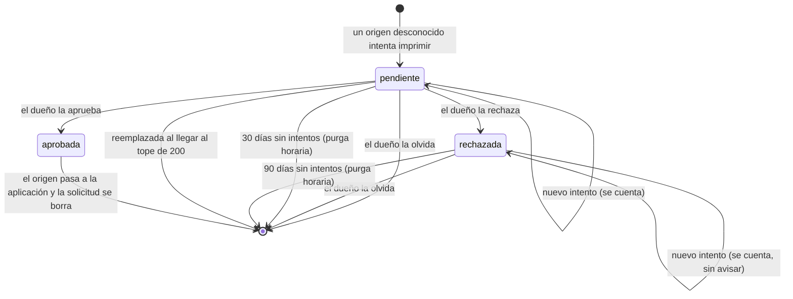

# Solicitudes de origen

¿Qué pasa con un origen desconocido que intenta imprimir?

Al llegar al tope, un origen nuevo reemplaza a la pendiente con la actividad más antigua. Si todas son rechazadas, el origen nuevo no se registra.

**Basado en:**

- internal/almacen/solicitudes.go (`Registrar`, `Aprobar`, `Rechazar`, `Eliminar`, `Purgar`, `MaxSolicitudes`)
- internal/admin/clientes.go (`aprobarSolicitud`, `rechazarSolicitud`, `olvidarSolicitud`)
- cmd/prisma/ejecutar.go (`mantenimiento`)
