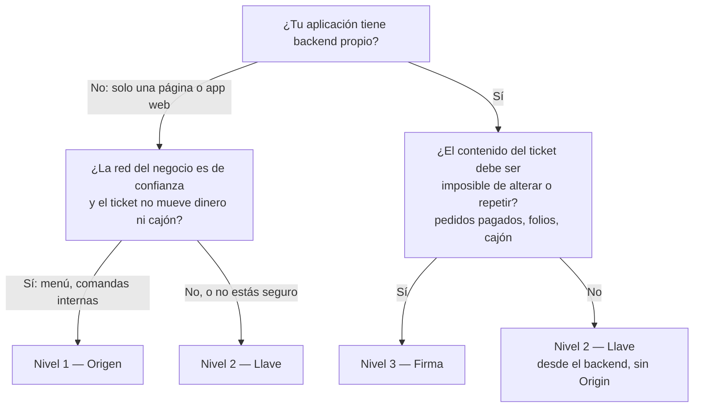
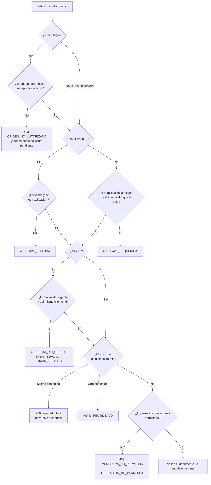
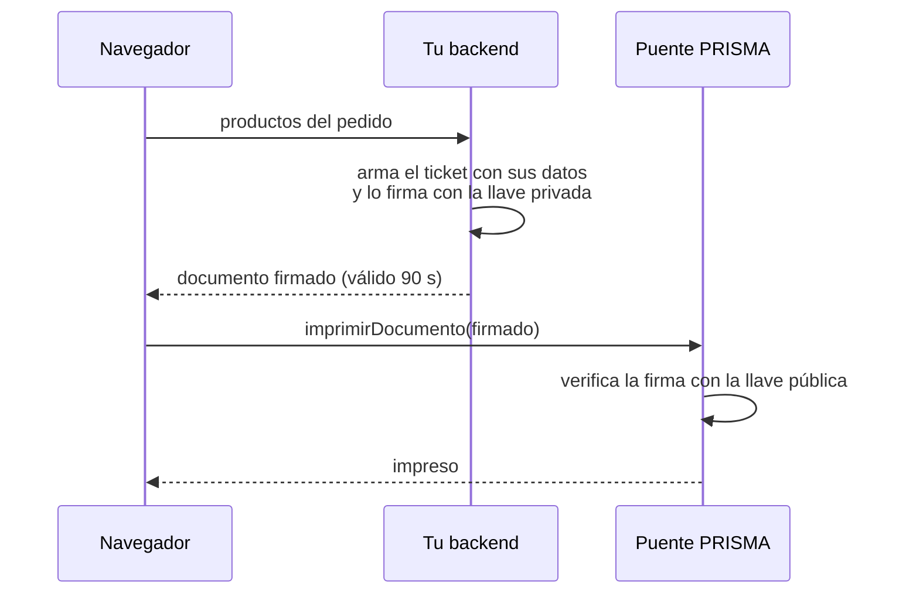

# Niveles de seguridad

El dueño del puente registra tu aplicación con uno de tres niveles. Cada uno añade una protección sobre el anterior:

| Nivel | Tu aplicación envía | Protege contra | No protege contra |
|---|---|---|---|
| **1 — Origen** | Nada extra: el navegador envía `Origin` solo. | Páginas web ajenas que intenten imprimir. | Programas fuera del navegador (curl, scripts) en la red, que pueden falsificar `Origin`. |
| **2 — Llave** *(por defecto)* | `Origin` aprobado (desde un navegador) y `Authorization: Bearer pk_…`. | Además, equipos de la red que no tienen la llave. | Quien tenga la llave. Una llave dentro de una página la puede leer cualquiera que vea el código fuente. |
| **3 — Firma** | Documentos firmados con Ed25519 por tu backend. El puente solo guarda tu llave **pública**. | Además, documentos alterados, repetidos o falsificados. Ni el navegador ni la red pueden cambiar un ticket. | Quien robe la llave privada de tu backend. |

Además, en todos los niveles:

- solo se imprime en las impresoras que el dueño permitió a tu aplicación;
- `abrir_cajon` y `raw` están deshabilitadas hasta que el dueño las habilite para ti.

## Cuál elegir



- **Nivel 1:** una carta digital que manda comandas a cocina, en una red sin invitados.
- **Nivel 2:** la opción por defecto. Sirve tanto en una página como en un backend o en una app de escritorio. Desde un servidor (sin navegador) basta la llave.
- **Nivel 3:** tiendas en línea y pedidos pagados. El backend decide qué se imprime y el puente puede comprobarlo.

## Cómo decide el puente

Cada petición pasa por estas comprobaciones, en orden. Se detiene en la primera que falla:



Si una petición no trae ni origen ni llave, el puente solo la acepta si trae un documento firmado: identifica a la aplicación por el `cliente_id` de la firma.

## Nivel 1 — Origen

```js
const prisma = new Prisma({ url: "https://192.168.1.10:8443" });
await prisma.imprimir("cocina", (d) => d.texto("Mesa 4: 2 tacos").cortar());
```

- El origen es esquema + nombre + puerto, **exacto**: `https://menu.mitienda.mx` y `https://www.menu.mitienda.mx` son orígenes distintos.
- Solo funciona desde un navegador. Fuera de él, el puente responde `ORIGEN_REQUERIDO`.

## Nivel 2 — Llave

```js
const prisma = new Prisma({ url: "https://192.168.1.10:8443", llave: "pk_7ax6nj4r4a_…" });
```

- La llave se muestra **una sola vez** en el panel. Si se pierde o se filtra, el dueño la regenera, y la anterior deja de funcionar en ese momento.
- Desde un navegador hacen falta el origen aprobado **y** la llave. Desde un servidor basta la llave.
- No la subas a un repositorio público. En una página web es visible para quien abra el código fuente: si eso importa, usa el nivel 3.

## Nivel 3 — Firma



- Tu backend arma el ticket y lo firma con [un firmador de referencia](firmar-documentos.md). El navegador lo entrega sin modificarlo. Si alguien lo altera en el camino, el puente lo rechaza con `FIRMA_INVALIDA`.
- Un documento firmado vence a los 120 s como máximo, y su `id` no se puede reutilizar durante 10 minutos. Así, una firma capturada no sirve para imprimir dos veces.
- Si el navegador hace de mensajero, el origen de tu página debe estar aprobado para la aplicación de nivel 3. Si tu backend está en la red del negocio, puede enviarlo directamente, sin `Origin` ni llave.
- El dueño puede exigir además la llave `pk_` (opción *Exigir también la llave pk_ en cada petición*).

Guía completa con PHP, Node.js y Python: [firmar-documentos.md](firmar-documentos.md).
