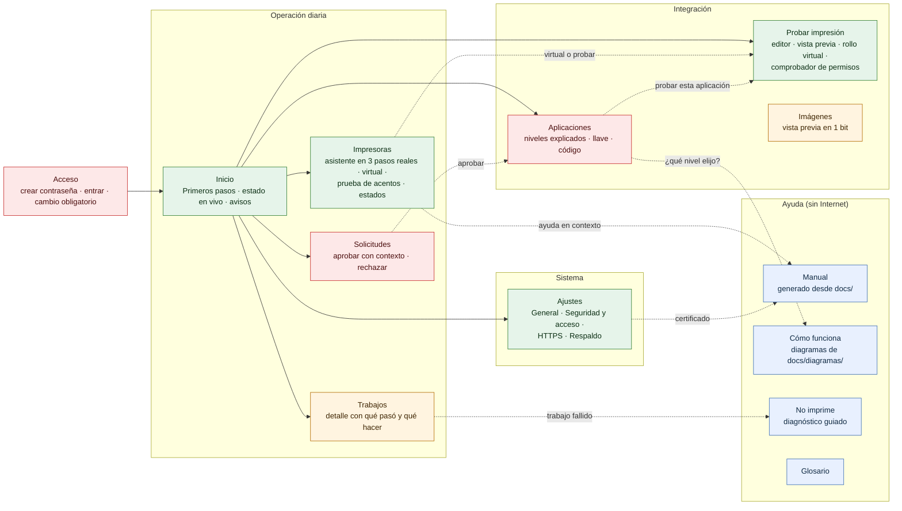

# Análisis del panel de administración (antes de la versión 1.1)

Fase 1 del trabajo de experiencia del panel: cómo está hoy, qué estorba a cada tipo de persona y qué proponemos cambiar. **Este documento no cambia código**: es la base para aprobar las fases siguientes.

- **Versión analizada:** rama `develop`, commit `8e10fda` (programa 0.1.0, API `/v1`, documento `"1"`).
- **Fecha:** 22 de octubre de 2026.
- **Capturas:** [antes/](antes/) (76 capturas en WebP de 40 pantallas o estados, en escritorio 1366×768 y celular 390×844, más los resultados de axe-core).
- **Cómo repetirlo:** [antes/sembrar.sh](antes/sembrar.sh) prepara los datos y [antes/recorrido.mjs](antes/recorrido.mjs) recorre el panel con Playwright y axe-core. Las capturas se nombran `NN-pantalla-escritorio.webp` y `NN-pantalla-celular.webp` (el recorrido genera PNG y [antes/a-webp.mjs](antes/a-webp.mjs) los convierte).

## Resumen

El panel de 0.1.0 tiene buena base técnica: sin dependencias, CSP estricta, errores con mensaje y sugerencia, confirmaciones en las acciones destructivas y modo oscuro. Lo que falla es la **experiencia de las primeras personas**:

1. **En celular, tres pantallas se salen de la pantalla a lo ancho** (Trabajos, Ayuda y el asistente de impresoras): la página entera se desplaza de lado y el botón «Continuar» del asistente queda tapado. Incumple WCAG 1.4.10 (reflujo).
2. **No hay ningún camino guiado** después de crear la contraseña: el Inicio vacío no dice qué hacer, en qué orden ni cuándo se terminó.
3. **No se puede probar sin impresora desde el panel.** La impresora virtual existe, pero solo en la terminal (`prisma dev impresora-virtual`). El integrador sin hardware no tiene ningún flujo.
4. **Cuando algo falla, el panel muestra un código y no qué hacer.** En Trabajos solo aparece `IMPRESORA_INALCANZABLE`, sin mensaje, sin sugerencia y sin enlace.
5. **La ayuda depende de Internet:** todos sus enlaces van a GitHub. Sin conexión no hay manual ni diagramas.
6. **El vocabulario es técnico:** alias, origen, nivel 1/2/3, página de códigos, «ESC t», fuente B, puntos por línea, DLE EOT, `TIEMPO_AGOTADO`, «rotar» o «revocar» la llave.

**Estimación frente a la meta** (recién instalado → ticket de prueba y aplicación autorizada, en menos de 5 minutos, sin ayuda):

| Escenario | Hoy | Por qué |
|---|---|---|
| Persona no técnica, impresora física de red, entrando desde el propio equipo | 6 a 10 min, con riesgo de abandono | Ningún camino guiado, jerga en el perfil, prueba de acentos difícil de interpretar, nada indica cuándo terminó. |
| La misma persona, desde otro equipo de la red | No lo logra sola | Necesita la terminal del equipo del puente (`prisma admin codigo-inicial`) y aceptar el certificado autofirmado. |
| Integrador sin impresora | No se puede desde el panel | Necesita la terminal y saber de `prisma dev impresora-virtual` o del conector `archivo`. |

## Método

- **Entorno.** PRISMA compilado de `develop` (Go 1.27.2, Windows 10) y dos puentes de prueba con su propia carpeta de datos y `modo_desarrollo = true`:
  - **recién instalado** (puerto 8444): sin contraseña ni datos;
  - **demo** (puerto 18443): 3 impresoras de red (`caja` y `cocina` en dos impresoras virtuales de `internal/dev`, de 80 y 58 mm; `barra` en un puerto cerrado), 2 aplicaciones (nivel 2 con llave y nivel 1), 2 solicitudes de origen pendientes y trabajos impresos, impresos con advertencia (`CARACTER_SUSTITUIDO`) y fallidos (`IMPRESORA_INALCANZABLE`).
- **Recorrido.** Playwright 1.56 con Chromium, `locale` es-MX, en 1366×768 y 390×844 (táctil, escala 2). Se capturaron los estados vacío, con datos, error, cargando y sin conexión. Los estados de error de la API y de carga se forzaron interceptando las peticiones.
- **Accesibilidad.** axe-core 4.10 con las reglas WCAG 2.0/2.1 A y AA en 12 pantallas por tamaño, más revisión manual del código (teclado, foco, ARIA y formularios).
- **Código revisado:** todo `internal/admin` (Go, `panel.js`, `panel.css`, `index.html`, `demo/demo.js`), las rutas `/admin` de `internal/servidor`, `internal/escpos`, `internal/conector`, `internal/cola`, `internal/dev`, `docs/administracion/` y los 27 diagramas de `docs/diagramas/`.

**Límites del análisis:**

- No se probó hardware real (USB, Bluetooth), Linux ni macOS.
- La detección de impresoras muestra las del equipo donde se hizo el análisis (Windows con impresoras de sistema).
- El navegador de pruebas acepta el certificado autofirmado, así que la advertencia del navegador no aparece en las capturas. Sí se cuenta en los flujos.
- Las capturas `44-llave-nueva-*` muestran una llave `pk_` real de un puente de prueba que ya se borró: no sirve en ningún otro puente.
- En este equipo hay un servicio PRISMA instalado en el puerto 8443. No se tocó; por eso los puentes de prueba usan otros puertos.

## Hallazgos priorizados

Prioridades: **crítico** (impide la meta o incumple una restricción del proyecto), **alto** (fricción fuerte o incumple WCAG AA), **medio** (confunde o hace perder tiempo) y **bajo** (pulido). La heurística es la de Nielsen afectada (N1 a N10, ver [la evaluación heurística](#evaluación-heurística-nielsen)).

### Críticos

**C1. En celular, la página entera se desplaza a lo ancho en Trabajos, Ayuda y el asistente de impresoras.**

| Pantalla | Ancho medido de la página (pantalla de 390 px) |
|---|---|
| Trabajos | 864 px |
| Ayuda | 716 px |
| Agregar impresora, paso 1 | 623 px |
| Las demás secciones | 390 px |

Capturas: [60-trabajos-celular](antes/60-trabajos-celular.webp), [25-asistente-paso1-celular](antes/25-asistente-paso1-celular.webp), [90-ayuda-celular](antes/90-ayuda-celular.webp).

- **Heurística:** N8. **WCAG:** 1.4.10 Reflujo (AA).
- **Impacto:** la barra superior y el contenido quedan desalineados. En el asistente, Playwright no pudo pulsar «Continuar» porque otro elemento lo tapa. En un celular real, el instalador ve la pantalla «rota» justo en el alta de la impresora.
- **Causa:** `.vista` es una rejilla con columna `auto`, que crece hasta el ancho mínimo de su contenido: la tabla de 7 columnas, las pestañas de Ayuda o la descripción larga de una impresora detectada (`Microsoft.Office.OneNote_16001…`, sin espacios). El contenedor `.tabla-caja` con `overflow-x: auto` no basta porque su padre ya creció.
- **Propuesta:**
  - `grid-template-columns: minmax(0, 1fr)` en `.vista`, y `overflow-wrap: anywhere` en los textos que vienen del sistema (detalle de detección, destinos, orígenes);
  - tablas como tarjetas apiladas por debajo de 640 px;
  - una prueba de Playwright que falle si `scrollWidth > innerWidth` en cualquier pantalla, en 390 px.

**C2. No hay camino guiado de «recién instalado» a «listo».**

Capturas: [03-inicio-vacio-escritorio](antes/03-inicio-vacio-escritorio.webp), [05-aplicaciones-vacio-escritorio](antes/05-aplicaciones-vacio-escritorio.webp).

- **Heurística:** N1, N10.
- **Impacto:** después de crear la contraseña aparece un aviso de 4 s («Contraseña guardada.») y un tablero con ceros. No dice qué es lo siguiente, ni cuántos pasos faltan, ni cuándo terminó. En Aplicaciones vacía no hay botón ni explicación de qué es una aplicación. La persona no técnica no sabe que debe agregar una impresora, probarla y luego autorizar su sistema.
- **Propuesta:** una lista «Primeros pasos» en Inicio, calculada con datos que el panel ya tiene (no hace falta guardar nada nuevo):
  1. agregar una impresora (física o virtual);
  2. imprimir el ticket de prueba y confirmar los acentos;
  3. autorizar una aplicación;
  4. en otros equipos, confiar en el certificado.

  Cada paso lleva un botón que abre el asistente correspondiente. Al terminarlos, la lista se reduce a una línea («Todo listo») que se puede ocultar. Los estados vacíos de cada sección explican qué es y llevan el botón principal.

**C3. No se puede probar la impresión sin impresora desde el panel.**

- **Heurística:** N7.
- **Impacto:** el integrador sin hardware y el instalador que llega antes que la impresora no pueden terminar ningún flujo en el panel. Hoy necesitan la terminal (`prisma dev impresora-virtual` y dar de alta `127.0.0.1:9100` a mano) o el conector `archivo`, que deja los tickets en una carpeta del equipo del puente que el panel no muestra.
- **Propuesta:** la Fase 6 (conector `virtual` y área «Probar impresión»), detallada en [el plan de reutilización](#plan-de-reutilización-para-probar-sin-impresora-fase-6).

**C4. La Ayuda y la documentación dependen de Internet.**

Captura: [90-ayuda-escritorio](antes/90-ayuda-escritorio.webp).

- **Heurística:** N10. **Restricción del proyecto:** el panel debe funcionar sin conexión, incluido el manual.
- **Impacto:** los 8 enlaces de Ayuda abren GitHub. En un negocio sin Internet, o con Internet pero sin saber leer un repositorio, no hay manual.
- **Propuesta:** el manual dentro del panel, generado desde `docs/` ([manual dentro del panel](#manual-dentro-del-panel)).

**C5. Un trabajo fallido solo muestra su código.**

Capturas: [61-trabajos-fallidos-escritorio](antes/61-trabajos-fallidos-escritorio.webp), [12-inicio-escritorio](antes/12-inicio-escritorio.webp).

- **Heurística:** N9, N2.
- **Impacto:** el dueño ve `IMPRESORA_INALCANZABLE` en una pastilla amarilla. El trabajo guarda solo el código, no el mensaje, así que el panel no puede mostrar qué pasó ni qué hacer. Las filas no se pueden abrir.
- **Propuesta:** un detalle del trabajo (al tocar la fila) con:
  - el mensaje y la sugerencia del código, tomados de [codigos-de-error.md](../referencia/codigos-de-error.md), que `go test ./docs` ya mantiene completo;
  - un botón para ir a la impresora y probarla;
  - el diagrama [23 «no imprime»](../diagramas/23-diagnostico-problemas.md);
  - la explicación del estado (diagrama [08](../diagramas/08-ciclo-vida-trabajo.md)).

  Lo mismo para las advertencias (`CARACTER_SUSTITUIDO` lleva a la prueba de acentos de esa impresora).

### Altos

**A1. El foco no se ve en las opciones de tarjeta** (nivel de seguridad, página de códigos, modo de aprobación).

Capturas: [42-aplicacion-nueva](antes/42-aplicacion-nueva-escritorio.webp), [23-paginas-codigos](antes/23-paginas-codigos-escritorio.webp).

- **WCAG:** 2.4.7 Foco visible (AA).
- **Detalle:** `.opcion input { position: absolute; opacity: 0 }` esconde el radio y ninguna regla dibuja el foco en la tarjeta. Con el teclado, el foco «desaparece».
- **Propuesta:** `.opcion:has(input:focus-visible) { outline: … }`.

**A2. Los errores de formulario no quedan junto al campo.**

Captura: [27-asistente-alias-vacio](antes/27-asistente-alias-vacio-escritorio.webp).

- **WCAG:** 3.3.1 Identificación de errores, 3.3.3 Sugerencias ante errores. **Heurística:** N9.
- **Detalle:** los errores llegan como aviso flotante que desaparece a los 7 s, o como la burbuja nativa del navegador, en el idioma del navegador («Please fill out this field»).
- **Propuesta:** `novalidate` en los formularios; el mensaje bajo el campo con `aria-invalid` y `aria-describedby`; el foco al primer campo con error; los errores de la API que nombran un campo, junto a ese campo.

**A3. El ejemplo del alias parece un valor ya escrito.**

Captura: [26-asistente-paso2](antes/26-asistente-paso2-escritorio.webp).

- **Heurística:** N5.
- **Detalle:** el campo Alias muestra «caja» en gris monoespaciado como `placeholder`. Parece lleno, la persona pulsa «Guardar» y recibe un error.
- **Propuesta:** proponer el alias a partir del nombre («Caja principal» → `caja-principal`, editable). El ejemplo va en el texto de ayuda, no dentro del campo.

**A4. La vista previa del ticket se corta y no se parece al papel.**

Captura: [22-diagnostico-celular](antes/22-diagnostico-celular.webp).

- **Heurística:** N2.
- **Detalle:** el diálogo de diagnóstico muestra el texto de la terminal (`dev.VistaTexto`) en una caja de 360 px. En 48 columnas se corta la derecha: falta el valor de «Alias» y la palabra «Derecha». El QR sale como bloques.
- **Restricción:** `dev.HTML` (la vista HTML que ya existe) usa `style="…"` y `<style>`, así que la CSP del panel la bloquea.
- **Propuesta:** una vista previa nueva, compatible con la CSP ([plan de reutilización](#plan-de-reutilización-para-probar-sin-impresora-fase-6)). Sirve también para la Fase 6.

**A5. La prueba de acentos exige entender «páginas de códigos».**

Captura: [23-paginas-codigos](antes/23-paginas-codigos-escritorio.webp).

- **Heurística:** N2, N6.
- **Detalle:** el diálogo muestra las 4 líneas como las dibuja el simulador, que decodifica bien las cuatro: la vista previa casi no ayuda, porque el problema real está en la tabla de la impresora. Las opciones se llaman «ESC t 16 · WPC1252 (Windows)».
- **Propuesta:** un asistente de acentos:
  1. «Se imprimieron 4 renglones numerados del 1 al 4»;
  2. «¿En cuál se leen bien *á é í ó ú ñ ¿ €*?», con botones grandes 1, 2, 3, 4 y «Ninguno»;
  3. «Ninguno» lleva a una ayuda con el diagrama de diagnóstico y a las opciones avanzadas.

  El nombre técnico queda en «Opciones avanzadas».

**A6. El paso «3. Probar y guardar» del asistente no existe.**

Capturas: [25-asistente-paso1](antes/25-asistente-paso1-escritorio.webp), [26-asistente-paso2](antes/26-asistente-paso2-escritorio.webp), [28-asistente-probado](antes/28-asistente-probado-escritorio.webp).

- **Heurística:** N1, N4.
- **Detalle:**
  - el indicador marca el paso 3 al pulsar «Probar conexión», pero sigue la misma pantalla;
  - guardar no imprime nada, y el aviso «Imprime el ticket de diagnóstico para comprobarla» desaparece a los 4 s;
  - en el paso 1 aparecen como «USB» las impresoras de sistema de Windows (Microsoft Print to PDF, XPS, OneNote, Fax).
- **Propuesta:**
  - 3 pasos reales: conexión, papel y prueba. El paso 3 imprime el diagnóstico y pregunta «¿Salió el ticket?» y «¿Se leen bien los acentos?»;
  - marcar las impresoras que no parecen de tickets («No parece una impresora de tickets») y ordenarlas al final;
  - la opción «Impresora virtual (para probar sin impresora)» en el paso 1.

**A7. El código de integración está desactualizado y elige una impresora al azar.**

Capturas: [44-llave-nueva](antes/44-llave-nueva-escritorio.webp), [41-codigo-integracion](antes/41-codigo-integracion-escritorio.webp).

- **Heurística:** N2, N5.
- **Detalle:**
  - dice «El SDK (prisma.js) está en camino», pero el SDK ya se publica como `@bayalad7/prisma` (`sdk/js/dist/prisma.mjs` y `prisma.umd.js`), e importa `./prisma.js`, un archivo que no existe;
  - usa la primera impresora en orden alfabético (en la demo, `barra`, que está fuera de línea);
  - el bloque de código se corta a la derecha;
  - no recuerda que cada equipo debe confiar en el certificado.
- **Propuesta:**
  - un selector de impresora (por defecto, una en línea, o la virtual);
  - la importación real del SDK (npm o el archivo `dist/`);
  - una pestaña «Probar» que lleve al área de pruebas, filtrada por esa aplicación;
  - el aviso del certificado con enlace al manual;
  - el código con ajuste de línea o desplazamiento accesible.

**A8. Desactivar una aplicación corta la impresión sin confirmar.**

- **Heurística:** N5.
- **Detalle:** «Desactivar» deja de imprimir de inmediato a esa aplicación, sin diálogo. «Eliminar impresora» advierte con un código (`IMPRESORA_NO_ENCONTRADA`) y no dice qué aplicaciones la usan.
- **Propuesta:**
  - confirmar «Desactivar» y decir qué deja de funcionar;
  - en «Eliminar impresora», listar las aplicaciones que la tienen permitida;
  - en «Restaurar», ofrecer antes «Descargar un respaldo de lo actual».

**A9. Las pestañas no siguen el patrón ARIA y los resultados no se anuncian.**

- **WCAG:** 4.1.2 y 4.1.3. axe: `scrollable-region-focusable` en los bloques `pre` del diagnóstico y de la llave.
- **Detalle:**
  - las pestañas (`role="tab"`, en Ayuda y en el código de integración) no tienen `aria-controls`, `tabpanel`, flechas ni `tabindex` itinerante;
  - el resultado de «Probar conexión» se escribe en un párrafo que no es región viva, así que el lector de pantalla no lo anuncia;
  - los `pre` desplazables no reciben el foco.
- **Propuesta:** un componente de pestañas accesible, `role="status"` en los resultados y `tabindex="0"` con `aria-label` en los `pre`.

### Medios

| # | Hallazgo | Captura | Heurística | Propuesta |
|---|---|---|---|---|
| M1 | Los textos técnicos aparecen sin explicación (ver [revisión de textos](#revisión-de-textos)). | [26](antes/26-asistente-paso2-escritorio.webp), [29](antes/29-asistente-avanzado-escritorio.webp), [42](antes/42-aplicacion-nueva-escritorio.webp) | N2 | Palabras simples con el término técnico entre paréntesis o en «Opciones avanzadas», más un glosario en el manual. |
| M2 | Nada se actualiza solo: el estado de las impresoras, la cola y el contador de solicitudes cambian en el puente, pero el panel no lo muestra hasta navegar. | [12](antes/12-inicio-escritorio.webp) | N1 | Refrescar el resumen cada 15 s mientras la pestaña está visible (`visibilitychange`), con la hora de la última actualización. Usa `GET /admin/api/resumen`, que ya existe. |
| M3 | «Hoy: 11 impresos, 5 con error» cuenta las pruebas del panel (diagnósticos y páginas), así que asusta al dueño con errores de prueba. | [12](antes/12-inicio-escritorio.webp) | N2 | Contar aparte los trabajos del panel (`cli_panel`), o excluirlos del «Hoy» y marcarlos «Prueba» en el historial. |
| M4 | Ajustes es una página larga con 7 formularios y 7 botones «Guardar», y mezcla lo cotidiano con lo peligroso (regenerar certificado, restaurar). En celular, la contraseña queda al fondo. | [80](antes/80-ajustes-celular.webp) | N8, N4 | Subsecciones: General, Seguridad y acceso, HTTPS y certificado, Respaldo; las acciones peligrosas en un bloque «Cuidado». |
| M5 | Aprobar un origen no da contexto: no dice si es una IP de la red local o un sitio de Internet, ni si usa `http` sin cifrar. El nivel se elige en un `select` sin explicación. | [51](antes/51-aprobar-origen-celular.webp) | N2, N5 | Etiquetas «Equipo de tu red» o «Sitio de Internet» y «Sin cifrar (http)»; nivel 2 recomendado, con una línea de explicación; después de aprobar, «Entrega esta llave a quien programa la aplicación», con copiar y descargar. |
| M6 | El nombre del puente se repite: la barra muestra «PRISMA / PRISMA» y la versión aparece dos veces. | [12](antes/12-inicio-escritorio.webp) | N8 | Si el nombre es el predeterminado, mostrar «Puente de impresión» e invitar a ponerle nombre; la versión solo en la barra. |
| M7 | Las impresoras desactivadas aparecen en Inicio con el estado crudo «inactiva», sin traducir ni color: `aJSON` devuelve `inactiva` y `ESTADOS_IMPRESORA` no lo tiene. | — (código: `panel.js`, `impresoras.go`) | N4 | Agregar «Desactivada» a los estados y a la leyenda. |
| M8 | En la tarjeta de impresora, los 5 botones pesan igual y el error repite el código: «IMPRESORA_INALCANZABLE: La impresora…». | [20](antes/20-impresoras-escritorio.webp), [21](antes/21-impresora-probar-error-escritorio.webp) | N8, N9 | Acción principal según el estado («Imprimir prueba» si está en línea, «Probar conexión» si no); el resto en «Más»; mensaje y sugerencia primero y el código al final, pequeño. |
| M9 | La sesión vence a los 30 min sin aviso y lleva al inicio de sesión, con lo que se pierde lo que se estaba escribiendo. | — (`sesiones.go`) | N3 | Avisar 2 min antes con «Seguir conectado» (una petición a `/admin/api/sesion`) sin cambiar los plazos. |
| M10 | Los avisos flotantes con información importante desaparecen solos (4–7 s). | [03](antes/03-inicio-vacio-escritorio.webp) | N1 | Las confirmaciones importantes se quedan en la página como nota cerrable; los avisos flotantes solo para lo trivial. |
| M11 | «Activa (las aplicaciones pueden usarla)» está dentro de «Capacidades», y la tarjeta no tiene botón «Desactivar», aunque [administracion/README.md](../administracion/README.md) dice que se puede desactivar. | [26](antes/26-asistente-paso2-escritorio.webp) | N4 | Mover «Activa» a «Identificación» y agregar «Desactivar / Activar» en la tarjeta. Así coinciden documentación y panel. |
| M12 | «Confirmar impresión» explica con jerga (DLE EOT, `TIEMPO_AGOTADO`) en un párrafo largo. | [26](antes/26-asistente-paso2-escritorio.webp) | N2 | Una línea simple («Preguntar a la impresora si recibió cada ticket; recomendado si tu impresora lo admite») y un enlace a la ayuda con el diagrama [25](../diagramas/25-confirmar-impresion.md). Mejor aún: que el paso 3 del asistente lo pruebe solo y lo active si la impresora responde. |

### Bajos

| # | Hallazgo | Propuesta |
|---|---|---|
| B1 | No hay enlace «Saltar al contenido» (WCAG 2.4.1); hoy la navegación es corta, pero crecerá con Ayuda y Probar. | Enlace oculto que aparece con el foco. |
| B2 | Las fechas usan el formato `es` genérico en lugar de `es-MX`. | Centralizar los formatos con la configuración regional en el archivo de textos. |
| B3 | Al navegar, el foco programático en `main` dibuja una línea azul a la izquierda del contenido (se ve en varias capturas). | Mover el foco al `h1` de la vista (`tabindex="-1"`) sin contorno, o quitar el contorno a `main:focus:not(:focus-visible)`. |
| B4 | El botón «Menú» del celular no se cierra con Escape ni al tocar fuera. | Cerrar con Escape y al tocar fuera; devolver el foco al botón. |
| B5 | «Rechazar» un origen no confirma (es reversible, está bien), pero no ofrece deshacer. | Aviso con «Deshacer» durante unos segundos. |
| B6 | En Trabajos no se sabe cuántos resultados hay ni si la lista está recortada. | Mostrar «N trabajos» y cargar más bajo demanda. |
| B7 | El mensaje del Inicio sin trabajos dice «No hay trabajos con estos filtros», pero ahí no hay filtros. | Mensaje propio: «Todavía no se ha impreso nada. Prueba tu impresora». |

## Comparación de los flujos

Se cuentan los clics, toques y campos desde que la persona decide hacerlo, sin contar la lectura. «Hoy» sale del código y del recorrido; «propuesto», de los cambios de este documento.

| Flujo | Hoy | Fricciones principales | Propuesto |
|---|---|---|---|
| **a) Primer arranque → contraseña → primer acceso** | Desde el equipo: abrir la URL, aceptar el certificado (2), 2 campos, 1 botón: **3 clics + 2 campos**. Desde otro equipo: además, abrir una terminal en el equipo del puente, ejecutar `prisma admin codigo-inicial` y copiar el código: **+1 campo y la terminal**. | No dice qué es PRISMA ni qué sigue; después del acceso, nada guía ([C2](#críticos)); el código inicial obliga a usar la terminal; la contraseña nueva no se puede mostrar. | Los mismos 3 clics, más un «Mostrar contraseña» y un medidor de solidez local. Al entrar, «Primeros pasos». El código inicial sigue igual (es la defensa contra el secuestro del puente), pero el texto explica dónde y cómo obtenerlo, con el diagrama [16](../diagramas/16-panel-sesion.md). |
| **b) Primera impresora → diagnóstico → acentos** | Impresoras (1), Agregar (1), elegir detectada (1) o escribir el destino (1 campo + 1), alias y nombre (2 campos), papel (1), Probar (1), Guardar (1), volver a la tarjeta, Diagnóstico (1), Cerrar (1), Probar páginas (1), elegir (1), Usar (1): **unos 13 clics y 3 campos**, más interpretar «ESC t». | Paso 3 falso; el ejemplo del alias parece valor; guardar no imprime; vista previa cortada; impresoras de sistema mezcladas; desborde en celular ([A3](#altos), [A4](#altos), [A5](#altos), [A6](#altos), [C1](#críticos)). | «Primeros pasos» → Agregar impresora (1), elegir detectada (1), nombre (1 campo, el alias sale solo), papel (1), «Probar e imprimir» (1, guarda e imprime), «¿Salió?» Sí (1), «¿Acentos? renglón 2» (1): **unos 7 clics y 1 campo**, sin jerga. |
| **c) Aplicación nivel 2 → llave y código → probar** | Aplicaciones (1), Agregar (1), nombre (1 campo), nivel (ya marcado), origen (1 campo + Agregar 1), Crear (1), Copiar llave (1), pestaña (1), Copiar código (1), Ya la copié (1): **unos 9 clics y 2 campos**. Probar: **no hay forma** en el panel. | El código cita un SDK «en camino» y un archivo que no existe; elige mal la impresora; no se puede comprobar que la app imprimió; «origen» sin explicación ([A7](#altos), M1). | Los mismos pasos con textos claros y selector de impresora. Después, «Esperando la primera impresión de tu aplicación…»: el área de pruebas muestra en vivo el primer trabajo de esa aplicación (éxito, o el error explicado). **+0 clics y un resultado verificable.** |
| **d) Aprobar una solicitud de origen** | Aviso en Inicio (1), Aprobar (1), modo, nombre y nivel, Aprobar (1), Ya la copié (1): **4 clics**. | Sin contexto de riesgo; el dueño recibe una llave y no sabe qué hacer con ella ([M5](#medios)). | Los mismos **4 clics**, con contexto de riesgo, nivel recomendado e instrucciones para entregar la llave (copiar o descargar un archivo de texto). |
| **e) Por qué falló un trabajo y qué hacer** | Trabajos (1), filtrar (1), leer el código. Para saber qué significa: abrir la Ayuda (1), un enlace a GitHub (1) y buscar el código: **4 clics, con Internet**. Desde el panel no hay solución. | Solo el código; sin detalle; la documentación está fuera ([C5](#críticos), [C4](#críticos)). | Tocar el trabajo (1): mensaje, sugerencia, «Probar esta impresora» (1) y el diagrama de diagnóstico. **2 clics, sin Internet.** |
| **f) Contraseña / certificado / respaldo** | Contraseña: Ajustes (1), bajar hasta el final, 3 campos, Guardar (1). Certificado: Ajustes (1), Regenerar (1), Confirmar (1). Respaldo: Ajustes (1), Descargar (1). | Página larga; el certificado regenerado obliga a reinstalarlo en cada equipo y el panel no lo recuerda después; la restauración no ofrece respaldar lo actual ([M4](#medios), [A8](#altos)). | Ajustes → Seguridad (2), 3 campos, Guardar (1). Ajustes → HTTPS → Regenerar (3), Confirmar (1), y luego una nota fija «Instala el certificado nuevo en cada equipo» con enlace al manual. Ajustes → Respaldo → Descargar (3). Mismo número de clics, con menos búsqueda y menos errores. |
| **g) Integrador prueba su app sin impresora** | **Imposible en el panel.** Con la terminal: `prisma dev impresora-virtual`, agregar la impresora `red 127.0.0.1:9100` (unos 8 clics en el asistente) y leer los tickets en la terminal. | Requiere terminal y saber que existe ([C3](#críticos)). | Impresoras → «Agregar impresora virtual» (2 clics, sin datos), autorizar la app (flujo c), imprimir desde la app y ver el ticket dibujado en «Probar impresión», con la respuesta JSON y los avisos. También se pueden simular «sin papel» o «desconectada» para probar el manejo de errores. |

## Evaluación heurística (Nielsen)

| # | Heurística | Nota (1–5) | Fortalezas | Problemas principales |
|---|---|---|---|---|
| N1 | Visibilidad del estado del sistema | 3 | Pastillas de estado con texto; contador de solicitudes; indicador en los botones mientras esperan. | Nada se actualiza solo (M2); el paso 3 del asistente es falso (A6); los avisos desaparecen (M10). |
| N2 | Coincidencia con el mundo real | 2 | Usa «Aplicaciones» en lugar de «clientes». | Jerga: alias, origen, ESC t, fuente B, DLE EOT, códigos en MAYÚSCULAS (M1, C5, A5). |
| N3 | Control y libertad | 3 | «Cancelar» en asistentes y diálogos; Escape cierra los diálogos. | Sin deshacer; la sesión vencida pierde lo escrito (M9). |
| N4 | Consistencia y estándares | 3 | Componentes coherentes (tarjeta, pastilla, botón). | «Aplicaciones» en pantalla y `#clientes` en la URL; «Activa» dentro de «Capacidades»; estado «inactiva» sin traducir (M7, M11). |
| N5 | Prevención de errores | 3 | Confirmaciones al eliminar; restaurar exige escribir RESTAURAR; el alias no se puede cambiar. | El ejemplo del alias parece valor (A3); desactivar sin confirmar (A8). |
| N6 | Reconocer antes que recordar | 3 | Formularios con valores típicos; el destino de ejemplo cambia según el tipo de conexión. | La prueba de acentos exige recordar el papel y traducir a «ESC t» (A5). |
| N7 | Flexibilidad y eficiencia | 2 | Detección automática y escaneo de red. | Sin forma de probar sin hardware (C3); sin atajos de teclado (no son prioritarios). |
| N8 | Estética y diseño minimalista | 4 | Limpio, sobrio, buena tipografía y modo oscuro. | Ajustes largo (M4); tarjeta de impresora con demasiados botones (M8); desborde en celular (C1). |
| N9 | Reconocer, diagnosticar y recuperarse de errores | 3 | Los errores de la API traen mensaje y sugerencia en español. | Los trabajos solo guardan el código (C5); validación nativa en otro idioma (A2). |
| N10 | Ayuda y documentación | 1 | Guía del certificado por sistema operativo. | Todo lo demás está en GitHub y requiere Internet (C4); sin ayuda contextual. |

## Accesibilidad (WCAG 2.1 AA)

**axe-core** (reglas WCAG 2.0/2.1 A y AA, 24 pantallas): una sola regla incumplida, `scrollable-region-focusable` (seria), en 5 pantallas (bloques `pre` del diagnóstico y de la llave, y la tabla del Inicio en celular). El contraste de color pasa en modo claro. Resultados completos: [antes/axe-antes.json](antes/axe-antes.json).

axe no detecta lo que depende del comportamiento. La revisión manual encontró:

| Criterio | Estado | Detalle |
|---|---|---|
| 1.3.1 Información y relaciones | Parcial | Las etiquetas de los campos están bien asociadas (`label for`). Los grupos usan `fieldset` y `legend`. Las tarjetas de opción esconden el radio, pero conservan la semántica. |
| 1.4.3 Contraste | Cumple (claro) | Por verificar en modo oscuro: axe solo corrió en claro. Se agregará a las pruebas. |
| 1.4.10 Reflujo | **No cumple** | C1. |
| 2.1.1 Teclado | **Parcial** | `pre` desplazables sin foco; pestañas sin flechas (A9). |
| 2.4.1 Evitar bloques | Parcial | Sin «Saltar al contenido» (B1). |
| 2.4.3 Orden del foco | Cumple | Orden lógico; los diálogos usan `showModal()`, que atrapa el foco y lo devuelve al cerrar. |
| 2.4.7 Foco visible | **No cumple** | Tarjetas de opción (A1). En el resto, el contorno es claro (captura [13-foco-teclado](antes/13-foco-teclado-escritorio.webp)). |
| 2.2.1 Tiempo ajustable | Parcial | Avisos que desaparecen (M10); la sesión vence sin aviso (M9). |
| 3.3.1 / 3.3.3 Errores | **No cumple** | A2. |
| 3.1.1 Idioma | Cumple | `lang="es"`; se propone `es-MX`. |
| 4.1.2 Nombre, función, valor | Parcial | Pestañas incompletas (A9); los segmentos 58/80 mm usan `aria-pressed` correctamente. |
| 4.1.3 Mensajes de estado | Parcial | Los avisos flotantes sí se anuncian (`aria-live`); los resultados en las tarjetas no (A9). |

**Propuesta para las pruebas:** axe-core en cada pantalla, en claro y oscuro, en escritorio y celular, más pruebas de teclado (recorrer cada asistente sin ratón) y de reflujo (C1), dentro de la suite de Playwright que correrá en el CI.

## Revisión de textos

**Etiquetas técnicas sin explicación** y propuesta en lenguaje llano. El término técnico se conserva entre paréntesis o en «Opciones avanzadas», porque el integrador y la documentación lo usan.

| Hoy | Dónde | Propuesta |
|---|---|---|
| Alias | Impresoras | «Nombre corto para las aplicaciones (alias)», propuesto a partir del nombre. |
| Destino | Impresoras | «Dirección de la impresora», con ejemplos según el tipo de conexión. |
| Página de códigos / Comando ESC t | Impresoras | «Acentos y ñ», con el asistente de A5; ESC t solo en avanzadas. |
| Columnas (fuente A/B), puntos por línea | Impresoras | En avanzadas, con «Déjalo así salvo que el diagnóstico salga cortado». |
| Baudios | Impresoras (Bluetooth) | «Velocidad del puerto (casi siempre 9600)». |
| Confirmar impresión (DLE EOT, `TIEMPO_AGOTADO`) | Impresoras | M12. |
| Origen / orígenes permitidos | Aplicaciones, Solicitudes | «Dirección de la página web que imprime (origen)», con un ejemplo y qué no lleva (rutas, comodines). |
| Nivel 1 · Origen / 2 · Llave / 3 · Firma | Aplicaciones | «Solo la dirección de la página» / «Dirección y llave secreta (recomendado)» / «Firma desde tu servidor (para desarrolladores)», con «¿Cuál elijo?» que abre el diagrama [27](../diagramas/27-elegir-nivel.md). |
| Operaciones sensibles, `abrir_cajon`, `raw` | Aplicaciones | «Permisos especiales: abrir el cajón de dinero / enviar comandos directos a la impresora (solo si el desarrollador lo pide)». |
| Rotar llave / Revocar llave | Aplicaciones | «Cambiar la llave» / «Quitar la llave». |
| Huella SHA-256 | Ajustes, Ayuda | «Huella (para comprobar que el certificado es el de este puente)». |
| Solicitudes de origen | Navegación | «Solicitudes» con la explicación «Páginas que quieren imprimir y esperan tu permiso». |
| CORS | No aparece en el panel; solo en docs | Sin cambios en el panel; el glosario del manual lo explica. |
| Códigos (`IMPRESORA_INALCANZABLE`…) | Trabajos, tarjetas, confirmaciones | Mensaje y sugerencia primero; el código pequeño al final (C5, M8). |

**Mensajes de error.** Los de la API del panel están bien hechos: dicen qué pasó y qué hacer, por ejemplo «Ya existe una impresora con el alias «caja». Elige otro alias.». Problemas:

- los trabajos solo guardan el código (C5);
- la validación nativa sale en el idioma del navegador (A2);
- algunos mensajes citan códigos en lugar de consecuencias («empezarán a recibir IMPRESORA_NO_ENCONTRADA»).

**Confirmaciones destructivas:**

- eliminar impresora, aplicación o imagen, cambiar o quitar la llave y regenerar el certificado: confirman con diálogo y botón rojo (bien);
- restaurar exige escribir RESTAURAR (bien);
- desactivar una aplicación no confirma (A8);
- regenerar el certificado no recuerda, después, reinstalarlo en cada equipo.

**Estados vacíos:**

- Impresoras vacía tiene botón (bien);
- Aplicaciones vacía no tiene explicación ni botón ([05](antes/05-aplicaciones-vacio-escritorio.webp));
- Solicitudes vacía no explica cómo llegan ([06](antes/06-solicitudes-vacio-escritorio.webp));
- Inicio vacío no guía (C2);
- Trabajos vacía usa el mismo texto genérico que el Inicio (B7).

**Externalización (i18n).** Hoy varios cientos de cadenas visibles viven dentro de `panel.js`. Propuesta:

- un solo archivo `internal/admin/web/textos.js` con un objeto `TEXTOS` por clave, con la configuración regional, los formatos de fecha y número y los plurales;
- `panel.js` solo usa claves;
- una prueba de Go que falle si `panel.js` tiene cadenas en español fuera de `textos.js`, con una lista corta de excepciones.

Los mensajes que vienen de la API siguen en el servidor, como hoy.

## Arquitectura de navegación propuesta

La navegación se agrupa por intención (operar, integrar y configurar). Se agregan **Probar impresión** y una **Ayuda** con manual, diagramas y solución de problemas. Cada pantalla tiene un «?» que abre la sección del manual correspondiente.

- En escritorio, la barra lateral muestra los cuatro grupos con un título pequeño. En celular, el menú desplegable conserva los grupos y suma un acceso fijo a «Probar» y «Ayuda».
- Las rutas usan el mismo `#hash` de hoy, renombrado de forma compatible: `#clientes` sigue funcionando y redirige a `#aplicaciones`. El manual usa `#ayuda/<ruta-del-doc>#<ancla>` para que los enlaces contextuales y el botón Atrás funcionen.
- El diagrama [15-panel-navegacion.md](../diagramas/15-panel-navegacion.md) se actualizará cuando se implemente.

## Inventario de diagramas

Los 27 diagramas se verificaron con el commit `5f67e19`. Desde entonces no hay cambios en `internal/`, `cmd/` ni `sdk/`, así que **todos están al día con el código actual**. Con la versión 1.1 quedarán desactualizados los que se marcan con ⚠ (cambian por las Fases 2 a 6).

Públicos: **U** usuario o dueño, **I** instalador, **Int** integrador, **D** desarrollador de PRISMA.

| # | Diagrama | Tipo | De qué trata | Público | Dónde mostrarlo en el panel | Estado |
|---|---|---|---|---|---|---|
| 01 | Contexto del sistema | flowchart | Navegador, apps, puente e impresoras | U, I, Int | Ayuda → Cómo funciona (portada); estado vacío del Inicio («¿Qué es PRISMA?») | ⚠ agregar la impresora virtual |
| 02 | Componentes y dependencias | flowchart | Paquetes de Go y sus relaciones | D | Manual → Arquitectura (solo en el manual) | ⚠ si el panel suma paquetes (manual, diagramas, virtual) |
| 03 | Flujo de impresión | flowchart | Del JSON al papel | Int, D | Probar impresión (panel lateral «Qué pasa al imprimir»); Ayuda → Cómo funciona | Al día |
| 04 | Imprimir en el nivel 1 | sequence | Autorización por origen | Int | Aplicaciones → formulario, junto al nivel 1 («Ver cómo funciona») | Al día |
| 05 | Imprimir en el nivel 2 | sequence | Origen y llave | Int | Aplicaciones → nivel 2; diálogo de la llave | Al día |
| 06 | Imprimir en el nivel 3 | sequence | Firma Ed25519 desde el backend | Int | Aplicaciones → nivel 3 | Al día |
| 07 | Orden de autorización | flowchart | Qué se revisa y en qué orden | Int, D | Manual de integradores; detalle de errores de autorización | Al día |
| 07 | Identificación del cliente, en detalle | flowchart | Cómo se reconoce al cliente | Int, D | Solo manual | Al día. **Comparte el número 07** con el anterior: se propone renumerarlo al publicar el visor (los enlaces viejos se redirigen). |
| 08 | Ciclo de vida de un trabajo | stateDiagram | encolado → completado o fallido | U, Int, D | Trabajos → detalle del trabajo | Al día |
| 09 | Cola por impresora | sequence | Un trabajo a la vez por impresora | Int, D | Impresoras («N en cola», ayuda); manual | Al día |
| 10 | Solicitudes de origen | stateDiagram | pendiente, aprobada, rechazada u olvidada | U, D | Solicitudes (ayuda contextual) | Al día |
| 11 | Modelo de datos | erDiagram | Tablas de SQLite | D | Solo manual; Ajustes → Respaldo («Qué contiene un respaldo») | ⚠ por la migración del conector virtual |
| 12 | Modos de TLS y certificado | flowchart | autofirmado, archivos y solo localhost | I, U | Ajustes → HTTPS; Ayuda → certificado | Al día |
| 14 | Arranque del servicio | sequence | Qué hace el puente al iniciar | D, I | Solo manual (operación) | Al día |
| 15 | Pantallas del panel | flowchart | Mapa del panel | U | Ayuda → Recorrido del panel | ⚠ cambia con la navegación nueva |
| 16 | Sesión del panel | sequence | Acceso, código inicial, bloqueo, CSRF | U, auditor | Ajustes → Seguridad y acceso; pantalla del código inicial («¿Por qué me lo pide?») | Al día (⚠ si se agrega el aviso de vencimiento, M9) |
| 17 | Detección de impresoras | flowchart | USB, serie y escaneo de red | I | Asistente, paso 1 («¿No aparece tu impresora?») | ⚠ si se filtran las impresoras de sistema (A6) |
| 18 | Conectores | flowchart | red, USB, Bluetooth y archivo | I, D | Asistente, paso 1; editar impresora | ⚠ agregar `virtual` |
| 19 | Despliegue por plataforma | flowchart | Servicio en Windows, Linux y macOS | I, D | Solo manual (instalación) | Al día |
| 20 | Integración continua | flowchart | CI y publicación | D | **No se muestra en el panel** (solo en el repositorio) | ⚠ por los pasos nuevos (SVG, Playwright) |
| 23 | Diagnóstico «no imprime» | flowchart | Árbol de decisión para soporte | **U**, I | Ayuda → No imprime; Trabajos → trabajo fallido; impresora fuera de línea. **El más valioso para el dueño.** | Al día |
| 24 | Idempotencia | flowchart | Reintentos sin duplicar | Int, D | Manual de integradores; Probar impresión (nota sobre el `id`) | Al día |
| 25 | Confirmar impresión | sequence | DLE EOT y avisos | I, Int | Editar impresora → «Confirmar impresión» | Al día |
| 26 | Estados de una impresora | stateDiagram | desconocido, en línea, ocupada, fuera de línea | U, Int | Impresoras (leyenda de estados) | Al día con la cola. El panel agrega «inactiva» (M7); conviene mencionarlo en sus notas. |
| 27 | Qué nivel elegir | flowchart | Decisión entre nivel 1, 2 y 3 | Int, U | Aplicaciones → «¿Cuál elijo?» | Al día |
| 28 | Actualización | sequence | `prisma actualizar` y firma | U, auditor | Inicio → aviso de versión nueva; manual de operación | Al día |

**Observaciones de forma:**

- Todos usan las clases comunes (`externo`, `prisma`, `datos`, `seguridad`) con colores fijos para fondo claro. En modo oscuro hay que mostrarlos sobre una superficie clara o generar una variante oscura (ver la siguiente sección).
- Varias etiquetas usan ` `, que obliga a etiquetas HTML (`foreignObject`) si no se configura Mermaid con `htmlLabels: false`.

## Opciones para mostrar los diagramas en el panel (Fase 5)

Requisitos: sin Internet, sin CDNs, cumpliendo la CSP del panel (`script-src 'self'`, `style-src 'self'`, sin `unsafe-inline`), `go build` sin Node, `docs/` como única fuente, contenido saneado y accesible, y buena lectura en 390 px.

| Opción | Cómo | Ventajas | Desventajas | Veredicto |
|---|---|---|---|---|
| **A. Mermaid en el navegador** | Embeber `mermaid.min.js` y dibujar en el panel. | Siempre fiel al Markdown. | Unos 3 MB en el binario y el panel; Mermaid inyecta `<style>` y `style="…"`, así que **exige `style-src 'unsafe-inline'`**; ejecuta código complejo con contenido de docs. | Descartada (rompe la CSP). |
| **B. SVG generados antes del build** | Un script de Node (el mismo mermaid-cli 11.4.2 fijado que ya usa `scripts/validar-diagramas.sh`) convierte cada bloque en SVG; los SVG se versionan y se embeben. | Ligero (decenas de KB por diagrama); `go build` no necesita Node; el CI ya tiene Node y mermaid-cli. | Hay que sanear el SVG y comprobar que no se quede viejo frente al Markdown; los estilos internos del SVG necesitan un tratamiento para la CSP. | **Recomendada.** |
| **C. Renderizador propio en Go o JS** | Interpretar un subconjunto de Mermaid. | Control total. | Meses de trabajo para 5 tipos de diagrama; resultados distintos a GitHub. | Descartada. |
| **D. PNG generados** | Igual que B, pero en imagen. | Ningún riesgo de estilos. | Texto borroso al ampliar, no se puede buscar ni seleccionar, pesa más y no admite tema oscuro. | Solo como respaldo si B falla en algún navegador. |
| **E. Enlazar a GitHub** | Como la Ayuda de hoy. | Cero trabajo. | Requiere Internet. | Descartada (restricción). |

**Recomendación (B) en detalle:**

1. **Generar.** `scripts/generar-diagramas.mjs` reutiliza `extraer-diagramas.mjs` y produce `internal/admin/web/diagramas/<archivo>.svg` y un `indice.json` con, por diagrama, el título, el archivo de origen y el **SHA-256 del bloque Mermaid**. Usa la configuración `htmlLabels: false` para que no haya `foreignObject`, solo `<text>`. Lo invocan `make diagramas` y `.\build.ps1 diagramas`.
2. **Sanear en Go, al generar y en las pruebas.** Una prueba de `go test ./internal/admin` abre cada SVG embebido y falla si encuentra:
   - `script`, `foreignObject`, `iframe`, `image` o `use` con referencias externas;
   - atributos `on*`;
   - URLs que no sean `#ancla`;
   - `@import` o `url(` hacia afuera.

   Usa una lista blanca de elementos y atributos.
3. **Comprobar que esté al día sin Node.** Otra prueba de Go recalcula el SHA-256 de cada bloque `mermaid` de `docs/diagramas/` y lo compara con `indice.json`. Si no coincide, falla con «ejecuta make diagramas». El CI además regenera y exige `git diff --exit-code`.
4. **Mostrar sin romper la CSP.** Los SVG se sirven como archivos estáticos (`/admin/diagramas/NN.svg`) y se muestran con ``, nunca insertados en el DOM: en modo imagen el navegador no ejecuta scripts ni carga recursos externos. Para que su `<style>` interno funcione, esas respuestas llevan su propia CSP mínima (`default-src 'none'; style-src 'unsafe-inline'`), solo para archivos SVG estáticos, saneados y generados por el proyecto. La página del panel conserva su CSP intacta. (Alternativa sin excepción: que el generador pase los estilos a atributos de presentación, `fill`, `stroke` y `font-size`, y quite el `<style>`; se evaluará en la Fase 5 y se elegirá la que pase las pruebas en Chromium, Firefox y Safari.)
5. **Leer bien:**
   - el visor abre el diagrama a pantalla completa con zoom (botones +/− y pellizco) y desplazamiento, aplicados por CSSOM;
   - en celular abre ajustado al ancho;
   - en modo oscuro, el diagrama va sobre una tarjeta clara (opción simple) o se genera una segunda variante con el tema oscuro (por decidir en la Fase 5).
6. **Accesibilidad:** el `alt` es el título y el texto de la pregunta del diagrama. Debajo se muestran las notas del Markdown (las viñetas que ya explican lo no obvio) como alternativa textual, y un enlace «Ver el texto del diagrama» que muestra el código Mermaid.

## Manual dentro del panel

Requisitos: `docs/` es la única fuente, funciona sin Internet, se sanea y cumple la CSP.

**Cómo llegan los Markdown al binario.** `go:embed` no admite rutas con `..`, así que `internal/admin` no puede embeber `docs/` directamente. El paquete `docs` ya existe (`docs/doc.go`, hoy solo con pruebas). Se le agrega `//go:embed` de los Markdown del manual y una variable exportada `docs.Manual fs.FS`; el panel la importa. No hay copias ni pasos de generación: lo que está en `docs/` es lo que se ve.

**Qué documentos.** Un índice versionado en `docs/` (por ejemplo, `docs/manual.json`) define el orden y los grupos del manual del panel: Primeros pasos, Impresoras, Aplicaciones, Problemas comunes, Certificados, Respaldo, Integradores, Referencia, Cómo funciona (diagramas) y Glosario. Una prueba exige que cada archivo del índice exista.

**Contenido nuevo** (en `docs/`, no en el panel), porque hoy `docs/administracion/` es breve (README de 56 líneas, `ajustes.md` de 14):

- `administracion/primeros-pasos.md`: de recién instalado a imprimir, para no técnicos, con capturas «después»;
- `administracion/glosario.md`;
- ampliar `ajustes.md` e `impresoras.md` con los flujos nuevos.

**Cómo se dibuja el Markdown** (dos opciones):

| Opción | Cómo | Ventajas | Desventajas |
|---|---|---|---|
| **1. goldmark en el puente** | Una ruta del panel convierte el Markdown en HTML con [goldmark](https://github.com/yuin/goldmark) (Go puro, MIT, sin CGO) y la extensión de tablas, con HTML crudo desactivado. goldmark ya filtra `javascript:` y similares. El panel inserta el resultado. | Soporte completo de lo que usa `docs/` (tablas, listas anidadas, código); probado por miles de proyectos. | **Una dependencia nueva**, que es una decisión técnica: requiere tu aprobación y un ADR. Inserta HTML: hay que confiar en el saneado (y en la CSP como segunda barrera). |
| **2. Renderizador propio en `panel.js`** | El panel descarga el Markdown crudo y lo convierte en nodos DOM con `createElement` y `textContent`, nunca `innerHTML`. | Sin dependencias; seguro por construcción (todo es texto); coherente con el ADR 0013 (panel sin frameworks). | Unas 300–400 líneas por mantener; hay que limitar la sintaxis de `docs/` a lo que soporta y comprobarlo con una prueba. |

**Recomendación: la opción 2.** El riesgo de seguridad es estructuralmente nulo (no hay HTML que sanear), no suma dependencias y el subconjunto que usa `docs/` es acotado: encabezados, párrafos, listas, tablas, código, citas, enlaces, negritas y código en línea. Una prueba de Go recorrerá los documentos del índice y fallará si aparece sintaxis no soportada (HTML crudo, notas al pie). Si prefieres robustez sobre cero dependencias, la opción 1 también cumple.

**Enlaces:**

- un enlace a otro documento del manual se abre dentro del panel (`#ayuda/ruta#ancla`);
- un enlace a un diagrama abre el visor;
- un enlace a código del repositorio (`internal/…`) se muestra como texto con la ruta, o como enlace externo marcado «requiere Internet»;
- un enlace externo se abre en otra pestaña con un ícono de «sale del panel»;
- los bloques `mermaid` se reemplazan por la imagen del diagrama generado (por el SHA-256 del bloque).

**Rutas nuevas del panel** (justificación: el manual necesita leer documentos embebidos que hoy no se sirven):

- `GET /admin/manual/<ruta>.md`: estático, solo los archivos del índice, `text/markdown`, con la misma sesión que el resto;
- `GET /admin/diagramas/<archivo>.svg`: estático.

Ninguna toca `/v1`.

## Plan de reutilización para probar sin impresora (Fase 6)

### Lo que ya existe

| Pieza | Dónde | Qué hace | Reutilización |
|---|---|---|---|
| `escpos.Renderizar` | `internal/escpos/renderizar.go` | Operaciones → bytes, con advertencias | Igual: el área de pruebas y la virtual usan el mismo camino que la impresión real. |
| `dev.Simular` → `dev.Pagina` | `internal/dev/simulador.go` | Interpreta los bytes ESC/POS como lo haría la impresora: renglones, tamaños, negritas, imágenes, cortes, cajón | **Base de la vista previa nueva**: se agrega una exportación de `Pagina` a JSON. |
| `dev.HTML` | `internal/dev/vista.go` | Vista HTML del ticket (la usan `/v1/previsualizar` y el SDK) | **No sirve en el panel**: usa `style="…"` y `<style>`, que la CSP bloquea. Se mantiene para `/v1` y el SDK (no se cambia `/v1`). |
| `dev.VistaTexto` | `internal/dev/vista.go` | Vista en texto (terminal) | La usa hoy el diagnóstico del panel; se reemplaza por la vista nueva (A4). |
| `dev.Traza` | `internal/dev/analizar.go` | Decodifica los comandos ESC/POS byte por byte | «Ver comandos» en el área de pruebas, para integradores y soporte. |
| `dev.ImpresoraVirtual` | `internal/dev/virtual.go` | Impresora TCP de prueba que responde a DLE EOT como en línea | Su lógica de respuesta a DLE EOT (`consultasEstado`, `EstadoEnLinea`) se reutiliza en el conector virtual. No se necesita TCP: el conector virtual vive dentro del puente. |
| Conector `archivo` | `internal/conector/archivo.go` | Guarda `.bin` y `.txt` en una carpeta | Modelo de conector sin hardware; el virtual es su versión en memoria y visible en el panel. |
| `escpos.PruebaPaginas` y `ticketDiagnostico` | `internal/escpos/herramientas.go`, `internal/admin/impresoras.go` | Tickets de prueba | Plantillas del área de pruebas («Diagnóstico» y «Acentos»). |
| `imprimirPrueba` | `internal/admin/impresoras.go` | Encola como `cli_panel`, guarda el trabajo y espera el resultado | El área de pruebas imprime por aquí: no hace falta una llave de cliente en el panel. |
| Validación del contrato | `internal/contrato` (JSON Schema y reglas) | Errores con ruta y regla | Validar el JSON del editor y señalar el renglón del error. |
| `ejemplos/validos/*.json` e `indice.json` | `ejemplos/` | Documentos de ejemplo (venta, comanda, logo con QR…) | Plantillas del área de pruebas. Se embeben con un paquete mínimo `ejemplos` (como `schema/schema.go`), sin copias. |

### Lo nuevo

**1. Conector `virtual`** (backend permitido por la excepción):

- **Tipo de conexión** `virtual` en `almacen`. **Migración `0002`:** la tabla `impresoras` tiene `CHECK (tipo IN ('red', 'usb', 'bluetooth', 'archivo'))`, y SQLite no permite cambiar un `CHECK` con `ALTER`: hay que reconstruir la tabla dentro de una transacción (crear la nueva, copiar, renombrar), conservando ids y llaves foráneas. Lleva una prueba de migración desde una base 0.1.0 real.
- **Comportamiento:** `Enviar` no hace E/S. Guarda en memoria los últimos tickets (por ejemplo, 20 por impresora y como máximo 2 MB en total) y responde según un **modo de simulación** elegido en el panel:
  - «En línea» (por defecto);
  - «Sin papel», que devuelve `conector.Aviso` con `IMPRESORA_FUERA_DE_LINEA`: el trabajo se completa con advertencia y se respeta la invariante;
  - «Desconectada», que devuelve `IMPRESORA_INALCANZABLE`: el trabajo falla y libera el id;
  - «Lenta», con 3 s de espera, para ver la cola.

  `Probar` responde según el modo. Así el integrador prueba el manejo de errores de su app sin hardware.
- **Privacidad (requiere tu decisión).** La invariante dice que nunca se registra el contenido de los tickets. Propuesta:
  - el contenido de los tickets **solo** se guarda en memoria, **solo** para impresoras virtuales, nunca en la base ni en la bitácora;
  - se borra al reiniciar, con un botón «Vaciar»;
  - el panel lo explica en la tarjeta de la impresora («Guarda en memoria los últimos 20 tickets para mostrarlos aquí»).

  Es equivalente a lo que hace hoy el conector `archivo`, pero sin disco.
- **`/v1/impresoras`:** campo aditivo `"virtual": true|false`. Se actualizan `openapi.yaml`, `docs/referencia/api-v1.md`, los tipos del SDK (`prisma.d.ts`) y el diagrama 18. Además, ADR nuevo «Impresora virtual dentro del puente».
- **Seguridad:** una impresora virtual se trata como cualquier otra (permisos por aplicación, límites, autorización). No abre puertos.

**2. Vista previa compatible con la CSP:**

- `dev.Pagina` gana una exportación a JSON: renglones con segmentos (texto, ancho, alto, negrita, subrayado, invertido, fuente), imágenes como PNG en base64 (`img-src` ya admite `data:`), cortes y apertura del cajón;
- el panel la dibuja con DOM y CSSOM (`el.style.width = …`), que la CSP permite sin `unsafe-inline`, como ya documenta `cspPanel`;
- se usa en el diagnóstico, en la prueba de acentos, en el área de pruebas y en los tickets recibidos por la virtual;
- se ajusta al ancho en celular (escala) para que nunca se corte (corrige A4).

**3. Área «Probar impresión»** (sección nueva):

1. Elegir la impresora; la virtual se sugiere si existe.
2. Elegir una plantilla (ejemplos, diagnóstico, acentos) o pegar el JSON propio, en un editor (`textarea` monoespaciado, sin librerías) con validación al escribir y errores con ruta.
3. «Vista previa» (sin imprimir) o «Imprimir».
4. Resultado: el ticket dibujado, las advertencias explicadas, la respuesta tal como la recibiría una app, la traza ESC/POS plegada y el tiempo.
5. Pestaña **«Recibidos»** de la impresora virtual: los tickets que llegan desde cualquier aplicación por `/v1/imprimir`, con su aplicación, referencia y resultado, actualizados cada 2 s mientras la pestaña está abierta. Es el flujo g) del integrador: su app real, con la autorización real, contra una impresora simulada.

**Rutas nuevas del panel** (todas bajo `/admin/api`, con sesión y CSRF; justificación: el área de pruebas necesita validar y dibujar documentos y leer los tickets virtuales, cosas que hoy no existen en el panel):

| Ruta | Para qué |
|---|---|
| `GET /admin/api/ejemplos` | Lista y contenido de las plantillas embebidas. |
| `POST /admin/api/pruebas/vista-previa` | Valida y dibuja un documento para una impresora: errores, advertencias y página en JSON. No imprime. |
| `POST /admin/api/pruebas/imprimir` | Imprime un documento como `cli_panel` (reutiliza `imprimirPrueba`). |
| `GET /admin/api/impresoras/{alias}/recibidos` | Tickets en memoria de una impresora virtual: página en JSON y metadatos. |
| `DELETE /admin/api/impresoras/{alias}/recibidos` | Vaciar. |

El modo de simulación viaja como campo de la impresora en `PUT /admin/api/impresoras/{alias}` (se agrega una columna en la misma migración 0002, o se guarda en el destino como `virtual:modo`; se decidirá en la Fase 6).

**Lo que cuidar** (invariantes ya verificadas por pruebas):

- un trabajo «Desconectada» libera su id;
- un trabajo «Sin papel» se completa con advertencia;
- ninguna goroutine de la virtual sobrevive a `Quitar`/`Cerrar` (`TestSinFugasDeGoroutines`);
- los instaladores no activan nada de esto por defecto (la virtual se crea a mano; no requiere `modo_desarrollo`).

## Plan acordado

El plan de fases que enviaste reemplaza mi propuesta de entregas. Las entregas E1–E13 de la versión anterior de este documento quedan repartidas así, en el orden que pediste:

| Orden | Fase | Contenido | Hallazgos que resuelve |
|---|---|---|---|
| 1 | **Fase 2 — Sistema de diseño** | Tokens (colores de estado, incluido «virtual»; tipografía, espaciado, radios, sombras; modo oscuro con selector manual), componentes accesibles (campos con error en línea, tablas que se vuelven tarjetas, pestañas ARIA, estados vacíos, pasos de asistente, bloque de código con «Copiar»…), sprite de iconos, `/admin/estilos` solo en modo desarrollo y prototipo de 3 pantallas clave. Incluye los arreglos de reflujo y foco, porque son del sistema de diseño. | C1, A1, A2, A9, B1, B3, B4 |
| 2 | **Fase 6.1 — Conector virtual** | Tipo `virtual`, migración 0002, rollo en memoria, fallas simuladas, campo `virtual` en `/v1/impresoras`, ADR. Va antes porque el asistente y las pruebas e2e lo usan. | C3 |
| 3 | **Fase 3 — Mejoras de UX/UI** | Asistente de primer uso, Inicio, Impresoras, Aplicaciones, Solicitudes, Trabajos con detalle, mensajes «qué pasó + por qué + qué hacer», formularios, navegación, textos en un solo archivo. | C2, C5, A3, A5–A8, M1–M12, B2, B5–B7 |
| 4 | **Fase 6.2–6.6 — Probar impresión** | Editor (plantillas, constructor visual, JSON), vista previa raster, «Enviar a…», rollo virtual, comprobador de permisos, «Copiar como código». | A4, C3, flujo g |
| 5 | **Fase 4 — Manual** | Ayuda sin Internet desde `docs/administracion/`, búsqueda local, ayuda contextual «?», árbol «Mi impresora no imprime» desde el diagrama 23, enlaces desde cada error. | C4 |
| 6 | **Fase 5 — Diagramas** | Front-matter, SVG claro y oscuro, manifiesto con hash, saneado, visor, galería, inclusión `{{diagrama:…}}`. | C4 |
| 7 | **Fase 7 — Verificación** | e2e de los flujos a)–g), axe, pruebas de diagramas y de la virtual, `docs/ux/despues/`, `docs/ux/RESULTADOS.md`, prueba de usuario nuevo, documentación y CHANGELOG. | Todos |

Cada entrega termina con capturas y un resumen, y espera tu aprobación. Lo que requiera cambiar el backend fuera de la excepción de la Fase 6 se anota en `docs/ux/PROPUESTAS-V2.md` y no se implementa.

## Decisiones tomadas

Respuestas del 22 de octubre de 2026:

1. **Versión: 0.2.0.** El programa sigue SemVer en 0.x; la API sigue en `/v1` y el documento en `"1"`. En la Fase 7, el CHANGELOG lleva **0.2.0**, no 1.1.0 como decía el plan.
2. **Tickets de impresoras virtuales en memoria: sí,** como excepción acotada a la invariante de no guardar tickets. Solo impresoras virtuales; los últimos N por impresora (20 por defecto); nunca en la base, la bitácora ni el paquete de soporte; se borran al reiniciar; botón «Vaciar rollo» y aviso en pantalla. Pruebas automatizadas lo verifican.
3. **Manual: renderizador propio en `panel.js`.** Convierte el Markdown en nodos DOM con `textContent` (nunca `innerHTML`), así que no hay HTML que sanitizar ni dependencias nuevas. **Se aparta del texto de la Fase 4**, que pedía HTML generado en el servidor: lo confirmaste explícitamente. El índice de búsqueda sí se genera en el build. Lleva un ADR.
4. **Diagramas: SVG versionados**, para que `go build` funcione sin Node. En la Fase 5 se probará primero quitar el `<style>` interno del SVG (estilos como atributos de presentación); si no se ve bien en Chromium, Firefox y Safari, los SVG estáticos tendrán una CSP mínima propia. La página del panel conserva su CSP.
5. **Capturas en WebP:** las 76 capturas pasaron de 7.7 MB en PNG a 4.8 MB en WebP (calidad 0.85). `recorrido.mjs` sigue generando PNG y [antes/a-webp.mjs](antes/a-webp.mjs) los convierte.
6. **Nombres en el panel: «Aplicaciones» e «Imágenes»,** no «Clientes» y «Recursos» como decía la Fase 3. El manual y el glosario explican que en la API y la CLI se llaman clientes y recursos. «Trabajos» conserva su nombre (no «Historial»).

**Cambios a mis propuestas por el plan:**

- **Vista previa:** el plan pide un raster a 203 dpi con aspecto de papel térmico. Reemplaza mi propuesta de dibujarla con CSSOM: el puente genera un PNG y el panel lo muestra con ``, que la CSP ya admite. La vista de texto y `dev.HTML` siguen para la terminal, `/v1/previsualizar` y el SDK.
- **Fallas simuladas:** «fuera de línea», «lenta» y «falla aleatoria», solo con códigos que la v1 ya reporta. Se quita mi «sin papel».
- **Rutas del panel:** el plan usa `/admin/ayuda`, `/admin/pruebas`, `/admin/pruebas/rollo/{alias}` y `/admin/estilos`. Hoy el panel navega con `#hash`. Se cambiará a rutas reales: `servirEstatico` devolverá `index.html` para las rutas de vistas conocidas. Es un cambio interno del panel, sin tocar `/v1`. Los enlaces viejos con `#` redirigen.
- **Front-matter de los diagramas:** `TestFormatoDeLosDiagramas` exige hoy un formato fijo. Se actualizará junto con el esquema del front-matter en la Fase 5.
